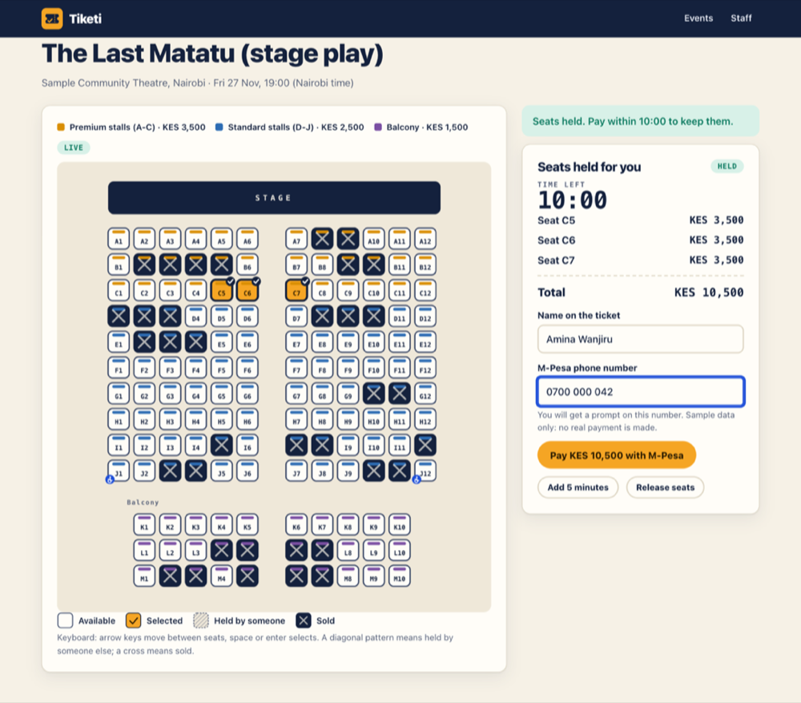
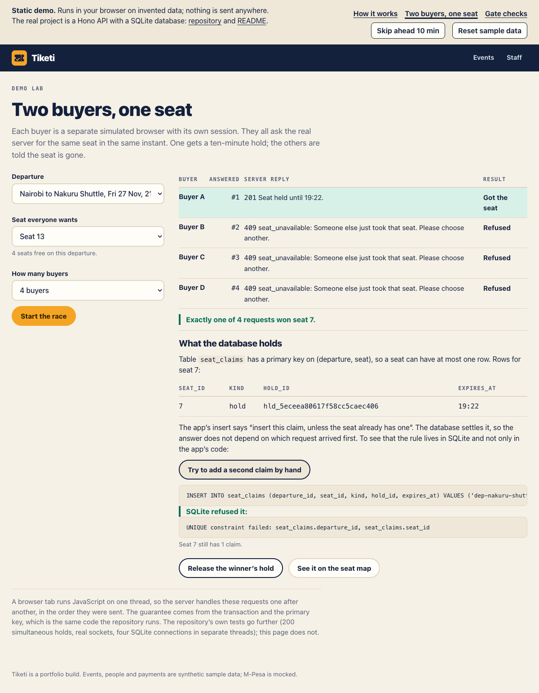
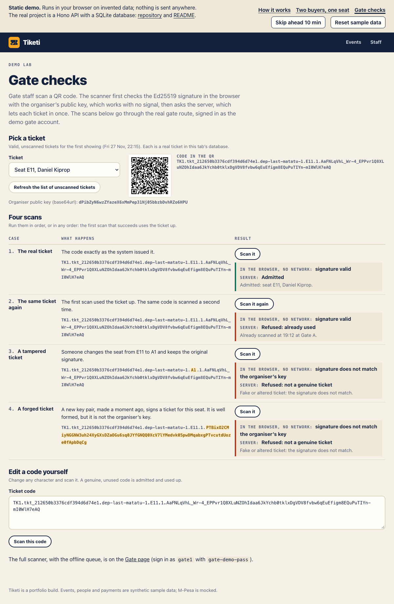
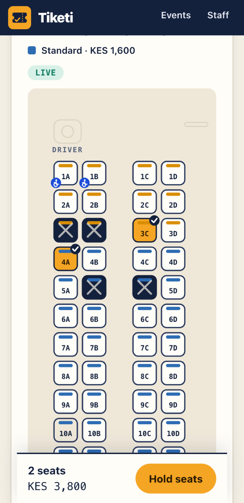
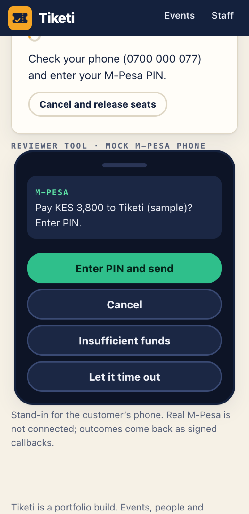
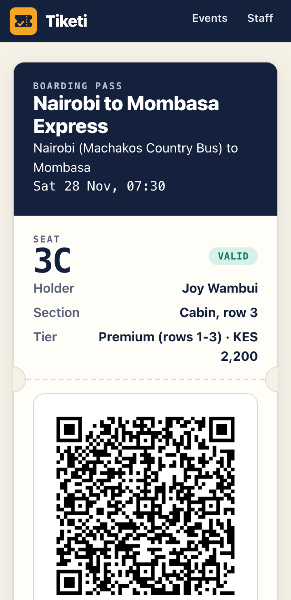
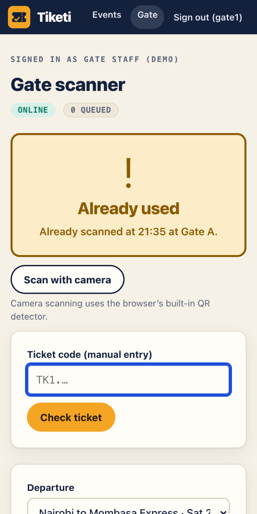
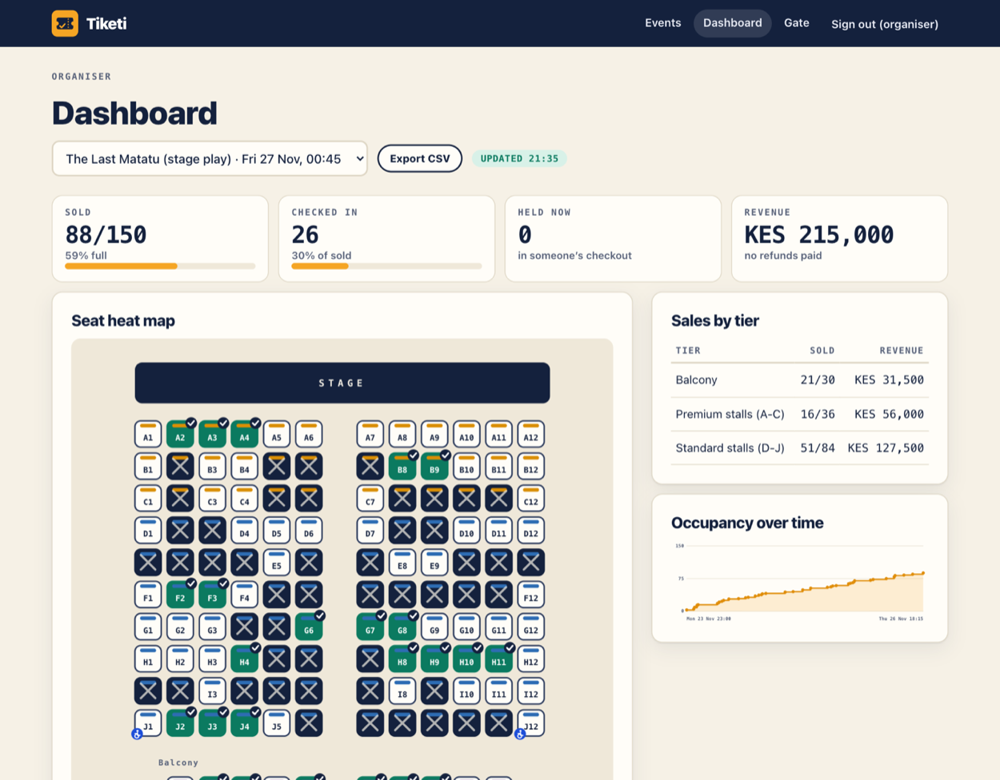
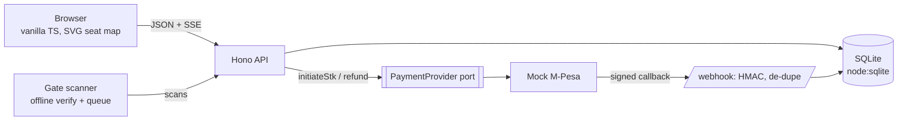

# Tiketi

**Seat booking and ticketing that cannot double-book a seat and cannot be fooled by fake tickets.**

**Live demo: <https://victor-wambua.github.io/tiketi/>** (runs entirely in your browser; no server)

[](https://github.com/Victor-Wambua/tiketi/actions/workflows/ci.yml)




> Status: portfolio build. Runs locally with synthetic sample data. Payments are **mocked** (no real M-Pesa), and camera scanning has not been tried on a physical phone. See [Status and limits](#status-and-limits).

## Live demo

[victor-wambua.github.io/tiketi](https://victor-wambua.github.io/tiketi/) runs the real thing in your browser. It is a static page, so there is no server: the repository's own Hono app, services and SQL run inside the page, with SQLite compiled to WebAssembly (sql.js) and a few Node built-ins swapped for browser adapters (`demo/src/shims`). Nothing under `src/` is changed for it, and nothing leaves your browser.

- **Real:** the routes, seat holds, the primary key that refuses a second claim, mock M-Pesa with signed callbacks, Ed25519 tickets, the gate and the dashboard, plus the front-end itself.
- **Simulated:** the network (`fetch` is answered in the page), the database file (in memory; reload resets), cookies, and time (a "Skip ahead 10 min" button). One JavaScript thread means requests run one after another, so true concurrency is only covered by the repository's tests.
- **Try:** hold seats and watch the timer, pay with the mock phone (success, cancel, no funds, timeout), skip ahead to expire a hold, race several buyers for one seat, and scan a valid, repeated, tampered and forged ticket.
- **Build it:** `npm run demo:build` (output in `dist/demo`). `npm run test:demo` builds it and drives it in Chromium; CI runs that on every push, and `tests/demoShims.test.ts` checks that the adapters give the same hashes and signatures as `node:crypto`.





## The problem

Event and coach bookings in Kenya often run on WhatsApp messages and phone calls. Two people get promised seat 7C. A "ticket" is a screenshot that can be forwarded and resold. At the gate, staff have no data to check it against, and the signal is often poor.

Tiketi is a small, complete answer to that: exact seats, a hold while you pay, a payment that can fail in every way M-Pesa can fail, and a ticket whose QR code staff can verify with no connection.

## What it does

- **Exact seats, never sold twice.** One database constraint allows at most one claim per seat. Holds last 10 minutes, can be extended once, and expire on their own. Shipped layouts: a 14-seater matatu, a 49-seater 2+2 coach and a 150-seat theatre (JSON seat maps with sections, rows, price tiers and accessible seats).
- **Customer flow on a 360px phone.** Seat map (SVG) with arrow-key navigation, screen-reader labels and states that differ by pattern, not only colour; live updates over server-sent events; hold countdown; pay; ticket.
- **Payments behind a port.** A `PaymentProvider` interface and a mock M-Pesa STK adapter. Outcomes (success, cancelled, timeout, insufficient funds) arrive later as HMAC-signed callbacks. A reviewer "phone" panel in the UI lets you choose the outcome.
- **Money errors are recorded, not lost.** Payment after the hold expired, the wrong amount, or a duplicate payment creates a refund-needed record for the organiser instead of a silent loss or a double sale.
- **Tickets that cannot be faked.** Each ticket is signed with Ed25519. The QR is rendered on the server as inline SVG. Transfer re-issues the ticket with a new version, so the old QR stops working. Cancelling voids it and refunds.
- **Gate scanner.** Verifies the signature in the browser with no network, then asks the server, which admits once ("Already scanned at 18:42 at Gate B"). Offline scans are queued, checked against a downloaded ticket list, and reconciled later. Camera scanning uses `BarcodeDetector` where available, with manual code entry as the fallback.
- **Organiser dashboard.** Sales by tier, seat heat map (available, held, sold, checked in), occupancy over time, gate throughput, offline conflicts, refunds to process, CSV export. Staff roles: organiser and gate.

| Phone: seat map                          | Phone: mock M-Pesa                         | Phone: ticket                          | Phone: gate replay                          |
| ---------------------------------------- | ------------------------------------------ | -------------------------------------- | ------------------------------------------- |
|  |  |  |  |



## Quick start

Needs Node 22.13 or newer (it uses the built-in `node:sqlite`).

```sh
git clone https://github.com/Victor-Wambua/tiketi.git
cd tiketi
npm ci
npm run seed      # synthetic events, tickets and demo staff (replaces data/tiketi.db)
npm run build     # builds the front-end into dist/web
npm start         # http://localhost:8787
```

Demo staff, created only by the local seed:

| Role       | Username    | Password              |
| ---------- | ----------- | --------------------- |
| Organiser  | `organiser` | `organiser-demo-pass` |
| Gate staff | `gate1`     | `gate-demo-pass`      |

Try it: open an event, pick two seats, **Hold seats**, enter any name and `0700 000 001`, **Pay**, then press **Enter PIN and send** on the mock phone. Copy the code under the QR into **Gate** (sign in as `gate1`). Scan it twice. Tick **Work offline** and scan another ticket to see the queue.

For development run `npm run dev` (API on 8787, Vite on 5173). Settings are in `.env.example`.

## How it works



Key decisions (the reasoning is in [docs/CASE-STUDY.md](docs/CASE-STUDY.md)):

- **The database refuses a double booking.** `seat_claims` has a primary key on `(departure_id, seat_id)`. A hold is an atomic insert-if-absent for all its seats inside one `BEGIN IMMEDIATE` transaction; if any seat is taken, everything rolls back. Expired holds are released lazily on read and by a sweeper.
- **A booking is confirmed only by a verified payment callback**, and only from a hold that is still active, unexpired and owned by the same session. Otherwise the money goes to a refund-needed record.
- **Every mutating request carries an `Idempotency-Key`.** Replays return the first answer. Sign-in, sign-out, the payment webhook (its own de-duplication) and the mock phone are the exceptions.
- **Offline verification has a stated limit.** A scanner with no signal cannot know about a transfer or a second scan at another gate. The server settles it when the scan syncs, and flags collisions for the organiser.

## Testing

```sh
npm test            # 95 tests, node:test, no network
npm run test:e2e    # Playwright (needs: npx playwright install chromium; npm run build)
npm run test:demo   # builds the static demo and runs its Playwright smoke tests
npm run check       # typecheck + lint + tests
```

Last run: **95 of 95 unit and integration tests pass**, **2 of 2 Playwright tests pass** and **8 of 8 demo smoke tests pass**. CI runs typecheck, lint, tests and build on Node 22 and 24, then the e2e job on Node 24.

| Area                    | Tests | What is covered                                                                                                                                                                                                                                                                                                                   |
| ----------------------- | ----- | --------------------------------------------------------------------------------------------------------------------------------------------------------------------------------------------------------------------------------------------------------------------------------------------------------------------------------- |
| Concurrency             | 6     | 200 simultaneous holds on one seat, in process and over real HTTP (100-socket pool), exactly one winner; the same race on an expired seat; randomised multi-seat stress that checks the global invariant after holds, releases, payments and cancels; expiry races; four SQLite connections in worker threads racing for one seat |
| Hold state machine      | 10    | TTL, lazy expiry, sweeper, one extension of +5 minutes, release, replacement, limits, DB constraint                                                                                                                                                                                                                               |
| Payments                | 17    | Happy path, bad HMAC, duplicate, late, wrong amount, cancelled/timeout/insufficient funds then retry, duplicate payment, refund once                                                                                                                                                                                              |
| Gate                    | 14    | Admit once, forged and foreign codes, transfer, cancel, two gates racing over HTTP, offline reconciliation                                                                                                                                                                                                                        |
| Scanner engine          | 8     | Offline admit and queue, drop mid-scan, reload, the transfer-while-offline limit, two offline gates                                                                                                                                                                                                                               |
| Auth and idempotency    | 15    | Role matrix on every staff endpoint, ownership checks, throttling, security headers, key replay and mismatch                                                                                                                                                                                                                      |
| Tickets and QR          | 8     | Flipping each of the 512 signature bits is rejected; field tampering; the rendered QR is decoded back with a QR reader                                                                                                                                                                                                            |
| Dashboard, CSV, layouts | 10    | Numbers, formula-injection safe export, 14/49/150 seats                                                                                                                                                                                                                                                                           |
| Demo adapters           | 7     | Browser hash, HMAC, scrypt and Ed25519 adapters give the same results as `node:crypto`; same-seed signatures are byte-identical                                                                                                                                                                                                   |
| e2e (Playwright)        | 2     | Two browser contexts race for one seat (one wins, the other is told and picks another), pay, ticket, gate admits then refuses replay, offline scan then sync; dashboard roles                                                                                                                                                     |

Not measured: code coverage percentage.

## Project layout

```
src/server/        Hono app, services (inventory, bookings, paymentCallbacks, tickets, gate, admin), schema
src/server/http/   routes and middleware (sessions, idempotency, security headers)
src/server/payments/  PaymentProvider port and the mock M-Pesa adapter
src/shared/        ticket code format + Ed25519 verify (used by server and browser), layout schema
src/web/           vanilla-TS front-end: pages, seat map, gate engine, styles
demo/              static demo: browser adapters, demo pages, Playwright smoke tests
layouts/           the three shipped seat maps (generated by `npm run layouts`)
tests/  e2e/       node:test suites and Playwright
docs/              case study, screenshots
```

## Configuration

| Variable                   | Default                    | Meaning                                                   |
| -------------------------- | -------------------------- | --------------------------------------------------------- |
| `PORT`                     | `8787`                     | HTTP port                                                 |
| `DATABASE_PATH`            | `data/tiketi.db`           | SQLite file                                               |
| `TICKET_KEY_PATH`          | `data/ticket-key.pem`      | Ed25519 private key; created on first start (git-ignored) |
| `MPESA_CALLBACK_SECRET`    | `dev-only-callback-secret` | HMAC secret for payment callbacks                         |
| `HOLD_TTL_SECONDS`         | `600`                      | Hold lifetime                                             |
| `MOCK_STK_TIMEOUT_SECONDS` | `60`                       | Unanswered mock prompt times out after this               |
| `MOCK_PAYMENTS`            | `1`                        | Serves the mock phone endpoints                           |

## Status and limits

Portfolio build, run only with synthetic data. Nothing here has real users or a live deployment.

- **Payments are mocked.** The callback shape follows Safaricom's STK callback, but the HMAC is this app's own protection; a real integration would also need Daraja credentials, IP allow-listing and a real reconciliation job. Not verified against the live API.
- **One node.** SQLite with an in-process event bus and in-memory sign-in throttle. Scaling out needs a shared database and bus.
- **Camera scanning is untested on a physical device.** The code path exists; the tests use manual entry. The offline app shell (service worker) is lightly exercised, not tested for a cold reload offline.
- **No SMS or email delivery.** Tickets are shown on screen and by link.
- **No UI for creating events.** Events and layouts come from the seed.

Next steps: a real STK adapter behind the same port, SMS ticket delivery, a signed offline "revocation" feed that includes recent transfers, event and layout editing, Postgres for multi-node.

---

Built by Victor Wambua · [portfolio](https://victor-wambua.github.io/victor-portfolio/) · [case studies](https://github.com/Victor-Wambua/case-studies)

MIT licensed.
