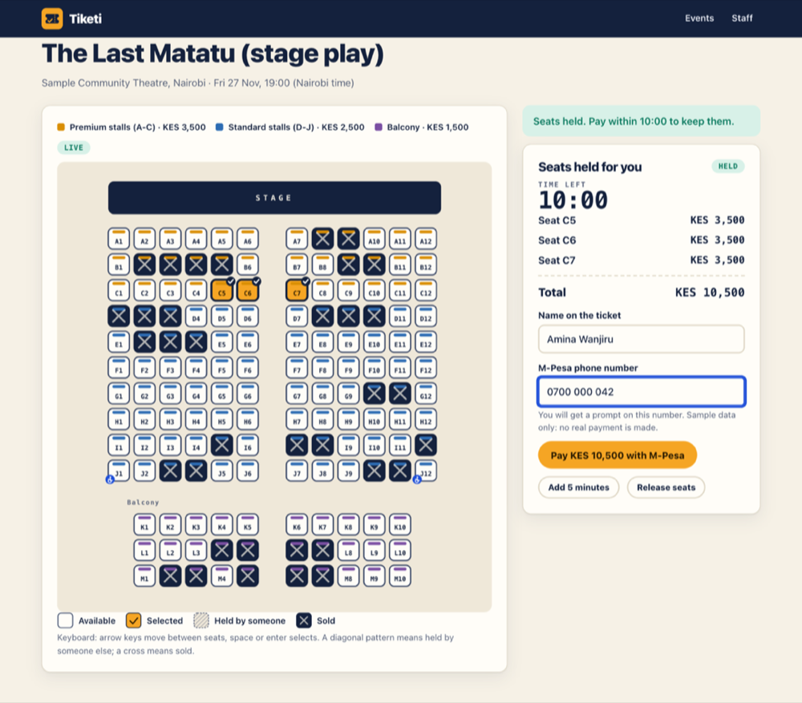

# Case study: Tiketi

## The problem

Small coach operators and event organisers in Kenya often sell seats over WhatsApp and phone calls. Three things go wrong. Two people are promised the same seat. The "ticket" is a screenshot, so it can be copied and resold. And at the gate, staff have nothing to check it against, often with no signal.

I wanted to build the smallest system that fixes all three and to be honest about what it cannot fix.

## Goals and non-goals

Goals: a seat can never be sold twice; a payment that arrives at the wrong moment never disappears; a ticket can be checked without trusting a screenshot, with or without network; an organiser can see what is happening.

Non-goals: a real payment integration, multi-node scale, event-creation tooling, or SMS delivery. Payments are a mock behind an interface, and the data is synthetic.

## What I built

A TypeScript app: Hono and `node:sqlite` on the server, a vanilla-TS front-end with an SVG seat map, no UI framework. Customers pick seats, hold them for ten minutes, pay through a mock M-Pesa prompt and get a signed QR ticket. Gate staff scan tickets in a web page that verifies signatures in the browser. Organisers get a dashboard.

## Design decisions and trade-offs

**1. A constraint, not a check.** The obvious code reads "is the seat free?" and then inserts a booking. Two requests can both read "free" before either writes. I made the seat itself the lock: `seat_claims` has a primary key on `(departure_id, seat_id)`, and a hold does `INSERT ... ON CONFLICT DO NOTHING` for each seat inside one `BEGIN IMMEDIATE` transaction. If any insert changes zero rows, I throw and the whole transaction rolls back, so a multi-seat hold is all or nothing. Even a future bug in the application cannot create two claims, because the database would refuse. I considered optimistic version counters on a seat row; they need a retry loop and still need a unique key underneath, so the key won.

**2. Holds are leases.** A hold has an expiry and is released two ways: lazily (any hold or read treats an overdue claim as free, so correctness never depends on a timer) and by a sweeper that tidies the rows. A hold can be extended once, by five minutes, and never past fifteen minutes in total. I considered unlimited extensions. They let one person sit on a popular seat indefinitely, so I capped them.

**3. The payment can arrive at any time.** This was the hard part. M-Pesa answers asynchronously, and the answer can come after the hold expired, twice, or with a different amount. My rules:

- A booking is confirmed only inside the callback transaction, only if the booking is still pending, the hold is active and unexpired, the hold belongs to the booking's own session, and every seat claim is still ours.
- Anything else produces a refund-needed record with a reason (late payment, wrong amount, duplicate payment, seat taken, booking cancelled). The organiser pays it out from the dashboard through the same payment port, once.
- When the prompt is sent, the hold is kept alive for the prompt timeout plus 30 seconds, so an on-time answer is not rejected because the clock ran out while the customer typed a PIN.
- The callback is verified with HMAC-SHA256 over the raw body (constant-time compare) and de-duplicated on a hash of reference, result code and receipt. A failure never overrides a recorded success.

I chose to refund every late payment, even when the seat happens to be still free. Auto-rebooking a stale payment is a surprise to the customer and a second code path to get wrong.

**4. Signed tickets, verified offline.** The QR carries `TK1.<ticketId>.<departureId>.<seat>.<version>.<signature>`, an Ed25519 signature over those fields. The server signs with `node:crypto`; the browser verifies with the public key using a small pure-JS library, and a test checks the two agree. The QR is generated on the server (I use a small QR library and a test that decodes my rendered SVG back to the exact code). Links to tickets carry an HMAC token that includes the ticket version, so after a transfer the old link and the old QR both die.

**5. What offline verification cannot prevent.** A signature proves a ticket was issued, not that it has not been used. A scanner with no signal cannot see a scan at another gate, a transfer made a minute ago, or a refund. I did not hide this. The scanner downloads a ticket list (id, version, status, already-scanned) while online and checks it offline, and it keeps a one-time-use cache on the device. Two devices can still both admit the same ticket while offline. The reconciliation policy when scans sync: the server admits a ticket with one compare-and-set update (`WHERE admitted_at IS NULL`); an offline collision is recorded for both sides, flagged for the organiser, and the earlier claimed time (clamped to be neither in the future nor before the ticket existed) is kept as the entry. Both people got in; the system reports it rather than pretending it prevented it. A scan made offline on a ticket transferred after the last sync is rejected at sync and recorded; the new holder can still enter.

**6. Idempotency on every write.** Mobile networks retry. Every mutating endpoint requires an `Idempotency-Key`; the first result is stored per caller, a retry replays it, and the same key with a different body is rejected. A double-clicked "Pay" sends one prompt. Sign-in, the webhook and the mock phone are exempt, and the webhook has its own de-duplication.

## How it is kept correct and safe

The tests are written around the failure modes, not the happy path (88 tests, plus 2 browser tests).

- **Concurrency.** 200 simultaneous hold attempts on one seat, in process and over real HTTP, give exactly one winner. Over HTTP I had to use a 100-socket pool, because macOS caps the listen backlog at 128 and 200 fresh connections got reset; the claim is "200 requests at once through 100 sockets". A randomised stress run, with 120 shoppers fighting over 20 hot seats and then paying, releasing and cancelling concurrently, checks the global invariant (at most one claim per seat, claims agree with holds and bookings, no two valid tickets for a seat) after each phase. A single SQLite connection in one Node process serialises writes by itself, so I also race four separate connections in worker threads; that run is what shows the constraint and the transaction doing the work, not the event loop.
- **Payments.** Bad HMAC, duplicate, late, wrong amount, failure after success, a second payment, a session mismatch.
- **Tickets.** Every one of the 512 signature bits flipped is rejected; changing seat, ticket, departure or version is rejected.
- **Gate.** Four gates sending five scans each for one ticket over HTTP: one admission, nineteen duplicates.
- **Security.** Role checks on every staff endpoint, ownership checks (a stranger gets 404 on someone else's hold or booking), scrypt password hashes, sign-in throttling, a strict CSP, a body size limit, CSV export that neutralises spreadsheet formulas.
- **Money** is integer KES everywhere; totals are computed on the server from the seat rows, never from the client.

## What I'd do differently, and what's next

I would write the invariant checker first. I wrote it after the first stress test and it immediately made the later tests cheaper. I would also put the offline ticket list on a signed, versioned feed so a scanner can prove how stale its list is. Next: a real STK adapter, SMS delivery of ticket links, event and layout editing, and Postgres if it ever needs more than one node (the claim insert maps directly onto a unique index).

## Status

Portfolio build, runs locally with synthetic data. M-Pesa is mocked: the callback body follows Safaricom's STK shape, but nothing talks to the real API, and the HMAC is this app's own protection. SQLite is single-node. Camera scanning is implemented with `BarcodeDetector` but I have not tried it on a physical phone; the tests use manual entry. There is no live deployment.
